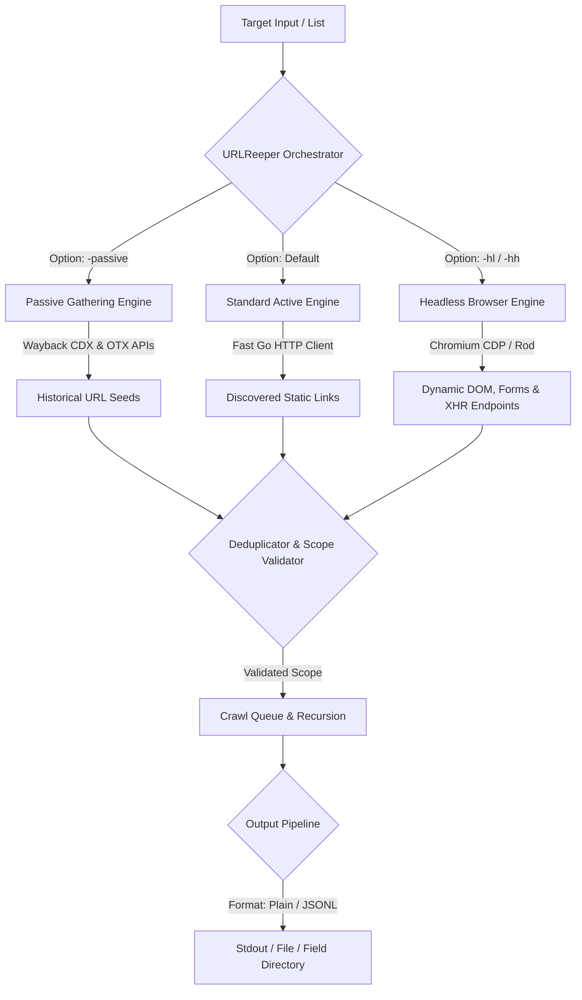

# URLREEPER

```text
██╗   ██╗██████╗ ██╗     ██████╗ ███████╗███████╗██████╗ ███████╗██████╗ 
██║   ██║██╔══██╗██║     ██╔══██╗██╔════╝██╔════╝██╔══██╗██╔════╝██╔══██╗
██║   ██║██████╔╝██║     ██████╔╝█████╗  █████╗  ██████╔╝█████╗  ██████╔╝
██║   ██║██╔══██╗██║     ██╔══██╗██╔══╝  ██╔══╝  ██╔═══╝ ██╔══╝  ██╔══██╗
╚██████╔╝██║  ██║███████╗██║  ██║███████╗███████╗██║     ███████╗██║  ██║
 ╚═════╝ ╚═╝  ╚═╝╚══════╝╚═╝  ╚═╝╚══════╝╚══════╝╚═╝     ╚══════╝╚═╝  ╚═╝
```

**URLReeper** is a next-generation hybrid active and passive web crawling and spidering framework designed for security reconnaissance, asset discovery, and automation pipelines. It combines passive web archive extraction with high-throughput HTTP crawling and full Chromium-based headless browser automation.

* **Author:** whoami_404
* **GitHub:** [github.com/youwannahackme/urlreeper](https://github.com/youwannahackme/urlreeper)
* **License:** [MIT](LICENSE.md)

---

## 🚀 Engine Architecture

URLReeper features a modular pipeline that coordinates active HTTP fetchers, passive threat-intelligence archives, and headless browser sessions into a deduplicated, scoped queue.



### 1. Passive Discovery Engine
Marrows out endpoints without directly connecting to target hosts:
* **Wayback Machine:** Queries Wayback CDX Server APIs to harvest cached and historical paths.
* **AlienVault OTX:** Fetches indexed URL databases for target domains.
* **Pipeline Seeding:** Discovered URLs are validated against scope and enqueued for recursive crawling.

### 2. Standard Active Engine
Optimized for high-concurrency, low-latency crawling:
* Uses a sized wait group, connection pooling, and cookie jar.
* Parses links, forms, scripts, anchors, and meta tags via GoQuery.
* Built-in path-similarity deduplication (Path Trie) to prevent endless crawling of repetitive dynamic paths (e.g., `/user/1`, `/user/2`).
* Strict scope boundary validation guarantees out-of-scope domains are never output unless explicitly requested (`-do`).

### 3. Headless Browser Engine
Uses [go-rod](https://github.com/go-rod/rod) to automate Chromium:
* **Dynamic SPAs:** Fully renders Single Page Applications (React, Angular, Vue, Next.js) to capture client-side elements.
* **XHR/Fetch Interception:** Intercepts browser network requests to capture dynamic REST and GraphQL endpoints.
* **DOM Interaction:** Supports automatic form detection and submission, event clicking, and CAPTCHA solving hooks.
* **Configurable Load Strategies:** Heuristic, DOMContentLoaded, Load, or NetworkIdle.

---

## ✨ Features

* **Purple CLI Aesthetics:** Signature purple banner in both execution and help menus.
* **Zero Out-of-Scope Leaks:** Strict scope enforcement across standard, hybrid, and headless engines.
* **Kali Linux & Root Optimized:** Auto-detects root execution (`EUID == 0`) and activates `--no-sandbox` automatically; auto-resolves `/usr/bin/chromium`.
* **Deep JavaScript Analysis:** Extracts endpoints from `.js` files using AST-based parsing (`jsluice`) and regex patterns.
* **Knowledge Base & Secret Extraction:** Classifies endpoints (REST/GraphQL/SOAP) and extracts sensitive keys, tokens, and credentials (`-kb-secrets`).
* **Smart URL Deduplication:** Fingerprints parameterized URLs (`-fsu`) and ignores redundant query arguments (`-iqp`).
* **Automatic Form Filling:** Generates and fills intelligent mock inputs for forms during headless crawls.

---

## 🛠️ Installation

URLReeper requires **Go 1.22+**.

### From Source (Recommended)

```bash
git clone https://github.com/youwannahackme/urlreeper.git
cd urlreeper
go build -o urlreeper ./cmd/urlreeper
```

To install directly to `$GOPATH/bin`:
```bash
go install -v ./cmd/urlreeper
```

### Linux / Kali Linux Users

On Kali Linux or Debian-based systems, install Chromium for headless crawling:
```bash
sudo apt update && sudo apt install -y chromium
```

Compile for Linux:
```bash
GOOS=linux GOARCH=amd64 go build -o urlreeper ./cmd/urlreeper
chmod +x urlreeper
```

> [!NOTE]
> When running as `root` on Kali Linux, URLReeper automatically applies `--no-sandbox` so Chromium launches without errors.

---

## 📖 CLI Usage

```text
Usage:
  ./urlreeper [flags]

Flags:
INPUT:
   -u, -list string[]     target URL or list to crawl
   -ps, -passive          enable passive URL discovery from web archives (Wayback Machine, AlienVault OTX)
   -resume string         resume scan using resume.cfg
   -e, -exclude string[]  exclude host matching filter ('cdn', 'private-ips', cidr, ip, regex)

CONFIGURATION:
   -r, -resolvers string[]              list of custom resolvers (file or comma separated)
   -d, -depth int                       maximum depth to crawl (default 3)
   -jc, -js-crawl                       enable endpoint parsing / crawling in JavaScript files
   -jsl, -jsluice                       enable jsluice AST parsing in JavaScript files
   -ct, -crawl-duration value           maximum duration to crawl the target for (e.g. 5m, 1h)
   -kf, -known-files value              crawl known files (all, robotstxt, sitemapxml)
   -mrs, -max-response-size int         maximum response size to read (default 4194304)
   -timeout int                         time to wait for request in seconds (default 10)
   -time-stable int                     time to wait until the page is stable in seconds (default 1)
   -aff, -automatic-form-fill           enable automatic form filling (experimental)
   -fx, -form-extraction                extract form, input, textarea & select elements in jsonl
   -retry int                           number of times to retry failed requests (default 1)
   -proxy string                        HTTP / SOCKS5 proxy to use
   -td, -tech-detect                    enable technology detection
   -H, -headers string[]                custom headers in header:value format
   -config string                       path to urlreeper configuration file
   -fc, -form-config string             path to custom form configuration file
   -flc, -field-config string           path to custom field configuration file
   -s, -strategy string                 visit strategy: depth-first, breadth-first (default "depth-first")
   -iqp, -ignore-query-params           ignore crawling same path with different query parameters
   -fsu, -filter-similar                filter crawling of similar URLs (e.g., /user/1 and /user/2)
   -fst, -filter-similar-threshold int  threshold before path position is treated as parameter (default 10)
   -tlsi, -tls-impersonate              enable TLS client hello (ja3) randomization
   -dr, -disable-redirects              disable following HTTP redirects
   -pc, -path-climb                     enable path climbing (auto crawl parent directory paths)
   -kb, -knowledge-base                 enable knowledge base classification
   -kb-secrets                          extract leaked API keys and secrets
   -kb-validate-secrets                 validate detected secrets against provider APIs
   -kb-endpoints                        classify REST, GraphQL, SOAP, and XHR requests
   -mdp, -max-domain-pages int          maximum pages to crawl per domain (default unlimited)

HEADLESS:
   -hl, -headless                         enable headless Chromium crawling
   -hh, -hybrid                           enable hybrid crawling (HTTP + selective headless)
   -sc, -system-chrome                    use local installed Chrome instead of downloaded binary
   -sb, -show-browser                     display browser window on screen during crawl
   -ho, -headless-options string[]        pass custom Chromium launch arguments
   -nos, -no-sandbox                      launch Chromium with --no-sandbox
   -cdd, -chrome-data-dir string          persistent Chrome user data directory
   -scp, -system-chrome-path string       explicit path to Chromium/Chrome executable
   -noi, -no-incognito                    disable incognito mode
   -cwu, -chrome-ws-url string            connect to existing Chrome instance via WebSocket URL
   -xhr, -xhr-extraction                  extract XHR/Fetch request URLs and methods
   -mfc, -max-failure-count int           max consecutive action failures before stopping (default 10)
   -ed, -enable-diagnostics               record headless crawl graph and diagnostics
   -pls, -page-load-strategy string       page load strategy: heuristic, load, domcontentloaded, networkidle, none (default "heuristic")
   -dwt, -dom-wait-time int               DOM stabilization wait time in seconds (default 5)
   -csp, -captcha-solver-provider string  CAPTCHA solver provider (e.g. capsolver)
   -csk, -captcha-solver-key string       CAPTCHA solver API key
   -al, -auto-login string                automatic authentication with username:password

SCOPE:
   -cs, -crawl-scope string[]       in-scope URL regex patterns to follow
   -cos, -crawl-out-scope string[]  out-of-scope URL regex patterns to exclude
   -fs, -field-scope string         scope field: dn, rdn, fqdn, or custom regex (default "rdn")
   -ns, -no-scope                   disable default host-based scope
   -do, -display-out-scope          display external out-of-scope URLs in results

FILTER:
   -mr, -match-regex string[]        regex to match on output URLs
   -fr, -filter-regex string[]       regex to filter out output URLs
   -em, -extension-match string[]    match specific extensions (e.g. php, html, js)
   -ef, -extension-filter string[]   filter out extensions (e.g. png, css)
   -ndef, -no-default-ext-filter     disable default file extension exclusions
   -mdc, -match-condition string     match response with DSL expression
   -fdc, -filter-condition string    filter response with DSL expression
   -duf, -disable-unique-filter      disable duplicate content filtering
   -fpt, -filter-page-type string[]  filter by page type (e.g. error, captcha, parked)

RATE LIMIT:
   -c, -concurrency int      concurrent network fetchers (default 10)
   -p, -parallelism int      concurrent input processing (default 10)
   -rd, -delay int           delay between requests in seconds
   -rl, -rate-limit int      maximum requests per second (default 150)
   -rlm, -rate-limit-minute int maximum requests per minute

OUTPUT:
   -o, -output string        write results to output file
   -j, -jsonl                output results in JSON Lines format
   -nc, -no-color            disable ANSI color codes in output
   -silent                   display discovered URLs only (suppress banners and logs)
   -v, -verbose              enable verbose log output
   -debug                    enable debug log output
   -version                  display version information
```

---

## 💡 Quick Examples

### High-Speed Standard Crawl
```bash
./urlreeper -u https://example.com -d 3 -jc
```

### Fast Headless Crawl (SPAs & Modern Web Apps)
```bash
./urlreeper -u https://example.com -d 3 -hl -pls domcontentloaded -dwt 1 -iqp -ct 3m
```

### Hybrid Crawl with Secret Extraction
```bash
./urlreeper -u https://example.com -hh -kb-secrets -j -o results.jsonl
```

### Passive Archive Reconnaissance
```bash
./urlreeper -u target.com -passive -depth 1 -o passive_endpoints.txt
```

### Clean Pipeline Output (Stdin & Stdout)
```bash
cat targets.txt | ./urlreeper -silent | httpx -silent
```

---

## 📄 License

This project is licensed under the MIT License. See [LICENSE.md](LICENSE.md) for details.
